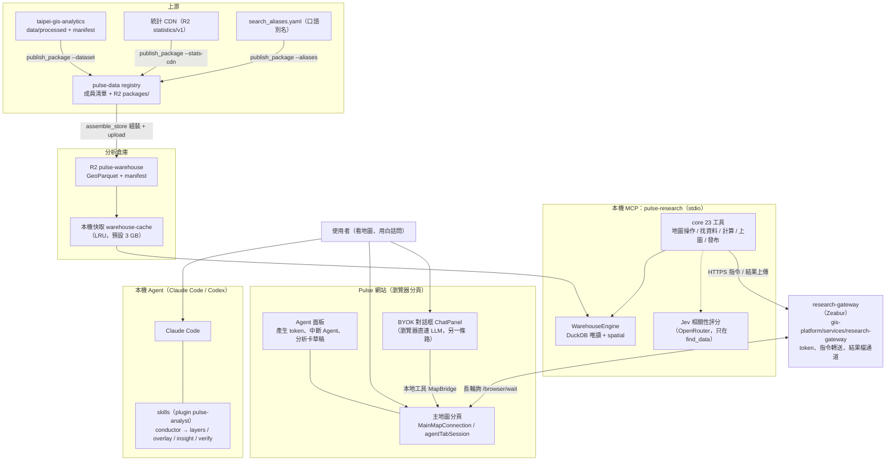
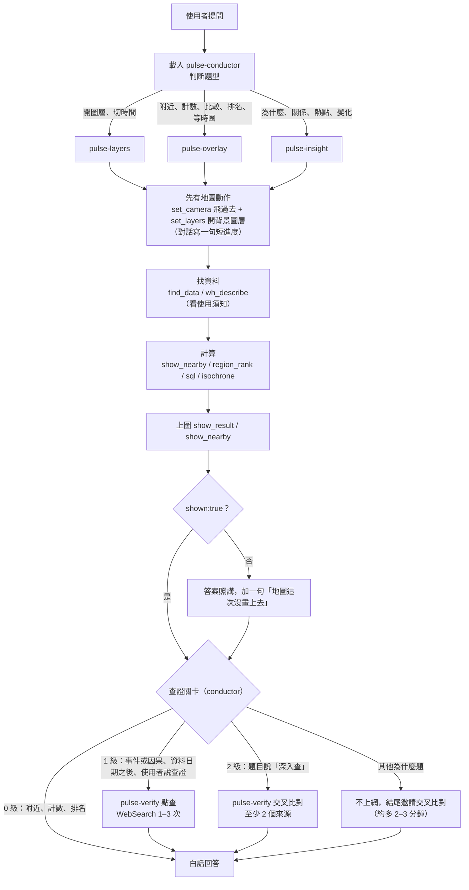
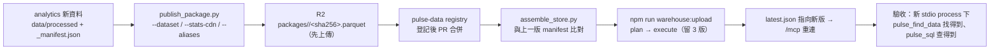

# Pulse AI Agent 地理分析：現行架構說明書

> 更新：2026-10-21。對應版本：MCP `mini-pulse-gis-mcp` origin/main `a3cc388`（含 #64–#73）、分析倉庫 `20261021T001522Z`（ADR-0023 組裝流程）。
> 前一版（v1，ADR-0016 之前的 42 工具／pulse-gis-analyst 架構）見 [pulse-research-system-guide-20260921.md](./pulse-research-system-guide-20260921.md)，只當歷史。

## 0. 一句話結論與文件定位

**一句話**：使用者在 Claude Code（或 Codex）用白話問地理問題，Agent 依 `pulse-conductor` skill 分派，透過本機 MCP `pulse-research`（core 23 個工具）在**本機 DuckDB 唯讀查詢分析倉庫**算出數字，再經雲端 research-gateway 把結果**畫到使用者已登入的 Pulse 地圖分頁**，確認 `shown:true` 之後才用白話回答。

本檔只回答「**系統現在怎麼運作**」。其他問題看這裡：

| 想知道 | 看哪裡 |
|---|---|
| 現在做到哪、下一輪從哪裡接 | `.gis-agent-system/roadmap/status/ai-mcp.md`「Agent 分析能力迭代」段（跨 repo 現況入口） |
| 為什麼這樣設計、下一步技術方向 | ADR-0014／0016／0017（`.gis-agent-system/decisions/`）；方向總結見 ADR-0022 `.gis-agent-system/decisions/0022-agent-analysis-technical-direction.md`（2026-10-18 採用，gis-agent-system #14） |
| 每一輪 eval 的分數、失敗分類 | MCP repo `eval/agent-regression/README.md`（最新、最細） |

數字都附出處（括號內是檔案路徑或 PR 號）；查不到的寫「未量測」。

---

## 1. 架構分層圖

### 1a. 元件分層



重點：

- **主線**是「Claude Code → MCP → gateway → 地圖分頁」。計算在本機 MCP 完成，gateway 不讀結果內容，只轉送指令和結果檔（ADR-0017 決策 1、4）。Mac 沒開就不能分析，這是刻意的取捨。
- **BYOK 對話框是另一條獨立支線**：`src/chat/agent.ts` 在瀏覽器直連使用者自填 key 的 LLM，用自己的 catalog／map／data 工具（`src/chat/tools/registry.ts`），tool loop 上限 10 步。它**不經 gateway、不碰 MCP、不讀分析倉庫**。本檔其餘章節講的都是主線。
- 倉庫只有 MCP 會讀；瀏覽器只負責呈現（ADR-0014 D3）。

### 1b. 一題問題的生命週期



只開圖層的題目，「上圖」的確認改成 `pulse_get_map_context` 讀回目標圖層確實開著，並用 `visibleSummary` 的數字講第二句（`plugins/pulse-analyst/skills/pulse-conductor/SKILL.md` 鐵則 1）。

---

## 2. 各層職責與關鍵檔案

| 層 | 職責 | 關鍵檔 | 更新方式 |
|---|---|---|---|
| Skills（plugin `pulse-analyst`） | 分派題型、三鐵則、回答格式、查證關卡、題型配方 | MCP repo `plugins/pulse-analyst/skills/*/SKILL.md`、`*/references/recipes/*.md` | MCP PR → main；正式環境 `analysis-prod/mcp` 重新 checkout（使用者層 skill 指向這裡） |
| MCP server | 工具註冊、server instructions、toolset 篩選 | `src/research/server.ts`（`RESEARCH_INSTRUCTIONS`）、`src/research/toolsets.ts`（`CORE_TOOLS`） | MCP PR → main → `analysis-prod/mcp`：`git checkout --detach origin/main && npm run build` → `/mcp` 重連（MCP `README.md`「正式部署路徑」） |
| 倉庫查詢引擎 | DuckDB 唯讀開啟、`enable_external_access=false`、SQL 守門、結果 `wh-N` 與 lineage | `src/warehouse/engine.ts`、`src/warehouse/discovery.ts`、`datasetUsageNotes.json`、`categories.json` | 同上 |
| 找資料加速 | `pulse_find_data` 先寬鬆比對，再交給 Jev 評分 | `src/warehouse/discovery.ts`（`DATA_RELEVANCE_THRESHOLD = 0.7`） | 同上 |
| 分析倉庫 | 每個 dataset 一張 `ds_*` 表，加行政界、統計長表、目錄、別名 | MCP repo `warehouse/publish_package.py`、`assemble_store.py`；pulse-data `registry/`（成員清單 SSOT）；R2 `pulse-warehouse`（`packages/` 不可變資料包＋`warehouse/<版本>/`） | `publish_package.py` 發包 → pulse-data PR → `assemble_store.py` 組裝 → `npm run warehouse:upload`（plan／execute，上傳後自動只留 3 版）→ `/mcp` 重連（ADR-0023；舊 `update_store`／`build_warehouse` 已停用）（`ai-mcp.md`「元件與位置」） |
| research-gateway | agent token、分頁綁定、指令 CAS 與轉送、長輪詢 wake、結果檔通道（sha256） | gis-platform `services/research-gateway/`（private repo） | gis-platform PR → Zeabur 部署 |
| 前端：主地圖連線 | 登入分頁自動建立 study、持有租約、長輪詢、執行指令並回報 ready | `src/research/agentTabSession.ts`（登入分頁自動擁有一個 study，不用配對碼）、`src/research/bridgeClient.ts`（長輪詢與結果通道的 timeout 鏈）、`src/research/StudyController.ts`（序列化 server 指令，本地操作優先）、`src/research/MainMapConnection.tsx`（把指令接到地圖、處理探索與分析結果呈現）、`src/research/ResearchConnection.tsx`（連線元件外殼，`/lab` 頁不接 query） | mini PR → develop → master 發布 |
| 前端：BYOK 對話框 | 使用者自填 key 的瀏覽器內對話（支線） | `src/components/chat/ChatPanel.tsx`（浮層面板，key 一律經 keyVault）、`src/chat/agent.ts`（streamText＋tool loop 上限 10 步） | 同上 |
| 端點契約 | gateway 端點、錯誤碼、timeout 鏈 | [bridge-contract.md](./bridge-contract.md)「正式站連線端點」、[SPEC-prod-connect-p1-p3.md](../general-analysis/SPEC-prod-connect-p1-p3.md) §2 | 隨 gateway／前端 PR |
| 回歸評估 | 題庫、評分規則、驗算 SQL | MCP repo `eval/agent-regression/`（`questions*.json`、`checks.ts`、`verification/*.sql`） | MCP PR；**不進 CI**（見 §7） |

gateway 主要端點（[bridge-contract.md](./bridge-contract.md)）：瀏覽器端 `/browser/wait`（長輪詢，同時回狀態與待處理 query）、`/browser/results/*`（下載結果檔並驗 sha256）；Agent 端 `/agent/tabs`（列活躍分頁）、`/agent/bind`（綁分頁、換短效 session）、`/commands`、`/agent/results/declare` + PUT 上傳（單筆上限 24 MiB）。agent token 每帳號最多 10 把、30 天到期。

---

## 3. 工具清單（core 23 個）

以 `src/research/toolsets.ts` 的 `CORE_TOOLS` 為準，共 23 個（`PULSE_TOOLSET=core` 為預設）。MCP `README.md` 寫的「50 tools」是舊的 full 模式數字，已過時；full 模式目前的實際數量**未量測**。

| 分組 | 工具 | 一句話 |
|---|---|---|
| 連線 | `pulse_pair_session` | 地圖沒接上、有多個分頁要選（choose_tab）、或要搶回分頁時用；用已存的 agent token，不用配對碼 |
| | `pulse_get_session` | 畫圖前確認地圖已接上；不是 active 就照回傳訊息請使用者處理 |
| 地圖操作 | `pulse_set_camera` | 題目一提到地點就先飛過去（街道 zoom 約 15、行政區 12、縣市 8） |
| | `pulse_set_layers` | 開關圖層；代號一定要先由 `pulse_search_layers` 查到，猜錯會回 `LAYER_KEY_UNKNOWN` |
| | `pulse_get_layer_controls` | 讀某圖層的滑桿、篩選、色盤等設定與目前值 |
| | `pulse_set_layer_control` | 改一個圖層設定（需帶目前值當 expectedValue） |
| | `pulse_set_time` | 切即時或回放時間 |
| | `pulse_get_map_context` | 讀回地圖現況：鏡頭、開著的圖層、載入中工作、`visibleSummary`（畫面內筆數、前 5 區、最大值） |
| 找資料 | `pulse_find_data` | **任何需要資料的題目先用它**；寬鬆比對表名、欄位、同義詞、統計指標，再由 Jev 分成 relevant／alsoConsider |
| | `pulse_search_layers` | 找要打開的地圖圖層 |
| | `pulse_describe_layer` | 讀一個圖層的意義、來源、可用性（不算數） |
| | `pulse_wh_describe` | 寫 SQL 前查一張表的欄位、筆數、授權、新鮮度、位置精度與使用須知 |
| | `pulse_find_places` | 用文字找預設視角（地標、行政區），不是地址定位 |
| | `pulse_geocode_address` | 地址或地名轉座標；預設本機離線，Google 要使用者同意並帶 `externalConsent:true` |
| 計算 | `pulse_nearby_profile` | 1–5 點、半徑內各類別計數與最近名稱（不畫圖；回答使用者時改用 `pulse_show_nearby`） |
| | `pulse_sql` | 沒有現成工具時的唯讀 SELECT／WITH；有 maxRows 上限，回傳 `wh-N` |
| | `pulse_region_rank` | 縣市／鄉鎮／村里依一個統計指標排名；缺值或保密值不排名、不當 0 |
| | `pulse_spatial_stats` | 熱點、群聚、集中度：`gi_star` 冷熱點、`lisa` 群聚與離群、`moran_global` 整體群聚、`lq` 區位商數；單位為行政區或 1000／500 m 網格，`scope.countyCode` 限單一縣市（村里必須限縣市）；確定性計算，回答只說「統計上顯著（5% 水準）」（ADR-0022 階段 A，MCP #70） |
| | `pulse_isochrone` | 「走路／騎車／開車 N 分鐘」用；打自架 Valhalla，結果也是可 join 的 `iso_wh_N` 表 |
| | `pulse_wh_get_result` | 分頁讀回之前的 `wh-N` 結果，不重算 |
| 上圖 | `pulse_show_result` | 一步完成匯入、取景、等 ready、讀回；最多 3 個結果；只有 `shown:true` 才能說地圖上有 |
| | `pulse_show_nearby` | 「這裡附近有什麼」：先取景、再算、再畫中心點＋半徑圈＋各類最近的點 |
| 發布 | `pulse_publish_card` | 使用者要求時，把已上圖的結果做成分析卡**草稿**；按發布鍵的是使用者，授權受限回 `CARD_NOT_PUBLISHABLE` |

不在 core 的工具（例如 Jev 路由 `pulse_route_request`、舊的 browser relay 分析工具）只在 `PULSE_TOOLSET=full` 才註冊（`toolsets.ts` 的 `toolsetRegistrar`）。

---

## 4. Skills 與配方

### 4a. 五個 skill

| skill | 何時載入 | 職責 |
|---|---|---|
| `pulse-conductor` | **唯一自動觸發**；每題都先載 | 分派題型、三鐵則、畫面節奏、回答格式與查證關卡的**唯一出處** |
| `pulse-layers` | conductor 點名 | 只找圖層、開關、調設定、切時間、移鏡頭，不計算；10 秒內讓使用者看到畫面並指出看點 |
| `pulse-overlay` | conductor 點名 | 附近、範圍內幾個、環域、A 和 B 比較、排名、等時圈；13 份配方（boundary-overlay、buffer-overlay、bus-first-last、compare-places、corridor-ranking、elderly-care-access、event-screening、food-access、infrastructure-proximity、isochrone-access、nearby-profile、region-rank、source-receptor） |
| `pulse-insight` | conductor 點名 | 為什麼、有沒有關係、熱點、群聚、變化、綜合評比；先畫「現象」再疊「對照」，最多 3 層 |
| `pulse-verify` | 只在查證關卡判定要查時 | 1 級點查（WebSearch 最多 3 次）或 2 級交叉比對（至少 2 個不同來源）；先有倉庫答案與地圖才上網，查證不改倉庫數字 |

出處：MCP repo `plugins/pulse-analyst/skills/*/SKILL.md`。來由見 ADR-0016（原本規則散在三處且互相矛盾，收斂成一個 plugin、唯一一份）。

### 4b. pulse-insight 的 10 份配方

多數配方用 `pulse_sql` 跑已驗證的 SQL 模板，複雜數學（z 值、Spearman 等）留給 Agent 算；空間群聚（LISA、Moran's I）改走確定性工具 `pulse_spatial_stats`。結果用 `pulse_show_result` 分兩段上圖。

| 配方 | 回答什麼問題 | 方法 |
|---|---|---|
| spatial-cluster-lisa | 有沒有空間群聚？群聚在哪、哪裡是高高／低低／離群？ | **全域 Moran's I＋LISA**，呼叫 `pulse_spatial_stats`（`moran_global`／`lisa`），queen 鄰接取自倉庫鄰接表；統計指標直接帶 `indicator`，鄉鎮可做全國、村里必須限縣市；無鄰居的離島單元標「未涵蓋」，不是 0 也不是「不顯著」；類別色上圖 |
| area-correlation | X 多的地方 Y 也多嗎？有沒有關係？ | 以村里／鄉鎮彙總後算 Pearson 相關（含 log 轉換）；點資料先換成密度；分縣市再算一次檢查方向 |
| hotspot-density | 哪裡特別集中？ | 行政區每平方公里密度、1 km 網格計數排名（只有密度，沒有顯著性） |
| hotspot-gi-star | 哪裡是統計上顯著的熱點？ | **Getis-Ord Gi\***：1 km 網格（含 0 值格、只留與縣界相交的格）、3×3 二元鄰接權重，z > 2.58 ≈ p<0.01；只示範單一縣市（例：臺北市 332 格，<1.5 秒），未做置換檢定或距離衰減 |
| clustering-ann | 這些點是集中還是分散？ | **最近鄰指數 ANN（Clark-Evans R）**：SQL 算每點最近鄰距離，Agent 算 R 與 z（z < -1.96 視為顯著群聚）；例：屏東縣畜牧場 n=2,256、ANN 0.384 |
| location-quotient | 哪個鄉鎮某產業特別多（超過全國比例）？ | **區位商數 LQ**＝鄉鎮行業占比 ÷ 全國占比；門檻：鄉鎮公司數 ≥50、該行業 ≥5；例：住宿業 LQ 最高是六龜區 61.4 |
| composite-index | 多個指標合成分數、哪裡綜合最好？ | 百分位、z-score 等權合成（越高越差的面向乘 -1）、**leave-one-out 敏感度**＋Spearman 名次相關 |
| change-over-time | 變多了嗎？前後差多少？ | 多期比較；有對照區時做**差異中的差異（DiD）**，要先畫出前幾期確認走勢平行 |
| news-persistence | 同一個地方連續好幾週都出現？ | gaps-and-islands 找連續週期（週序號減組內排名）；週以台灣時間切 |
| event-context-timeseries | 兩件事的時間走勢同不同步、誰先動？ | 週序列相關＋領先落後 ±1 週；只取兩序列收集窗口的重疊段（窗口外補 0 會把「沒收集」當「沒發生」） |

出處：`plugins/pulse-analyst/skills/pulse-insight/references/recipes/*.md`。Moran's I／LISA 已由 `pulse_spatial_stats`＋`spatial-cluster-lisa` 配方承接（MCP #70）；其餘配方（Gi\*、ANN、LQ 等）仍是「SQL 模板＋Agent 自己算」，是否也改走工具見 §10 方向 A。

---

## 5. 分析倉庫

### 5a. 內容（2026-10-18 基準；版本更新到 2026-10-21）

倉庫版本由 ADR-0023 的組裝流程產生：成員清單在 pulse-data `registry/`（每份資料一筆，`warehouse:` 區塊記資料包；核心表在 `_warehouse_core.yaml`），材料是 R2 `pulse-warehouse` 的不可變資料包 `packages/<table>/<sha256>.parquet`，組裝程式不再掃描 analytics。下表數字是 `20261017T213124Z`（P0 凍結基準，439 檔全部登記）；之後的版本在它之上加三張鄰接表與新發包的資料，**新版的檔數、大小、列數本檔未重量**。

| 項目 | 值 | 出處 |
|---|---|---|
| 正式版本 | `20261021T001522Z`（發包日本住宿 OSM 後組裝；前一版 `20261020T232834Z` 加三張鄰接表） | `ai-mcp.md`「現況」；ADR-0023「結果」段 |
| 保留的版本 | `001522Z`／`232834Z`／`213124Z`（3 版；`213124Z` 是 P0 凍結基準，也是退版用） | 同上 |
| 基準版本 | `20261017T213124Z`（建立 2026-10-17 21:31 UTC；下列檔數、大小、列數為這一版） | analysis-prod `runtime/warehouse-cache/20261017T213124Z/manifest.json`（本機快取，不進 git） |
| 檔案數 | 439（431 張 `ds_*` 資料表＋8 張核心表） | manifest.json `totals.files` 與逐檔 `core` 旗標 |
| 總大小 | 5,982,750,856 bytes（約 5.98 GB） | manifest.json `totals.bytes` |
| 資料表總列數 | 35,556,572（431 張 `ds_*` 合計） | manifest.json 逐檔 `rows` 加總 |
| 核心表 | `boundaries_county`／`town`／`village`（20261020 起另有 `boundaries_{county,town,village}_neighbors` 三張 queen 鄰接表，給 `pulse_spatial_stats`）、`boundaries_prosecutor_district`、`stats_observations`（統計長表）、`wh_catalog`、`wh_coverage`、`wh_search_aliases` | manifest.json |
| 線上統計 | 88 個 dataset／507 個指標 | `ai-mcp.md`「現況」 |
| 每表欄位 | `_row_id`、原屬性欄、`geom`（EPSG:4326）、`geom_3826`（TWD97 TM2，公尺運算；台灣範圍才填）、多檔時 `_source_file` | MCP `warehouse/README.md`「輸出」 |
| 保留政策 | R2 `warehouse/` 只留最近 3 版，上傳後自動清（MCP #54，`--keep 3`）；`packages/` 不會被 prune | 使用者 2026-10-06 決定；ADR-0023 |

10-17 這版是重建：同檔名多種格式（`.geojson`／`.csv`／`.parquet`／`.fgb`）只收一份，57 個資料集 4,901,790 → 2,580,848 列；公司內部專案資料不入倉（MCP #64–#67，eval README 第四階段）。

### 5b. L1／L2／L3 分級

| 層 | 意義 | 現況 |
|---|---|---|
| L1 可操作 | 可搜尋、開關、描述（來自 layer manifest） | 1,174／1,174 層 |
| L2 可分析 | 對應到倉庫 dataset（spatial／statistics／attribute） | 954／1,174 層（81.3%）；不可分析 182、只有舊 browser reader 6、共用混合幾何表缺 rowFilter 27 |
| L3 位置精度 | official／address_geocode／google_geocode／village_centroid／proxy／unknown | 屬性，不是關卡：只決定回答要加什麼但書 |

出處：定義見 ADR-0014 D1、[PLAN-warehouse-20260926.md](../general-analysis/PLAN-warehouse-20260926.md)；數字見 [layer-status-summary.md](../general-analysis/layer-status-summary.md)（2026-10-12 由 `scripts/research/build-layer-status.mjs` 產生）。ADR-0014 寫的 778 層是 09-26 的舊值。

### 5c. 入倉流程（ADR-0023：發包 → 組裝 → 上傳）



- **清單 SSOT 是 pulse-data `registry/`**（ADR-0019／0023）；不在清單上的資料不進倉庫。發包程式先上傳資料包，全部成功才改 registry，所以 registry 不會指向不存在的包。
- **三種發包**：`--dataset <id>`（點線面表，必須剛好對到一份 manifest，狀態 OK／WARN）、`--stats-cdn`（統計長表，只增不減，要下架才加 `--allow-shrink`）、`--aliases`（一律讀 analytics `origin/master`）。`wh_catalog`／`wh_coverage` 在發包時一併更新。
- **防落後**：發包前檢查 analytics checkout 是否落後 origin、dataset 目錄是否有未提交改動；`--allow-stale` 才放行並記錄。
- **組裝比對**：`assemble_store.py --reference-manifest <上一版>` 列出新增、移除、內容差異；新增表要 `--allow-add`、核心表（如 `wh_catalog`）要 `--allow-change`，移除與非預期差異 exit 1、不切 `latest.json`。
- 舊流程（`update_store.py` 增量、`build_warehouse.py` 全量掃描）**已停用**，寫正式 store 要 `--legacy`；根因與取捨見 ADR-0023。
- 「資料上線完成」的定義包含入倉並實測答得出來（`ai-mcp.md` 開頭）。**L2 可分析的判定**：在 pulse-data registry 有 `warehouse` 區塊，且已組裝上線（本 repo `CLAUDE.md` §5b 的「能自動入倉」以此為準）。
- 每個 dataset 的狀態碼與 issues 見 MCP `warehouse/README.md`。

### 5d. 中文口語別名

- 正本：analytics `docs/data-catalog/search_aliases.yaml`（key＝dataset_id，可細到 indicator；例：肺結核→結核病、刷卡→信用卡）。
- 只改別名：改 yaml 並 merge 進 analytics master → `publish_package.py --aliases` → 組裝 → `npm run warehouse:upload`，不用改 MCP 程式（MCP `warehouse/README.md`「新資料入口」）。
- 舊的 `SYNONYM_GROUPS`（`discovery.ts`，上限 60 組）保留，但新詞一律加 yaml。
- 踩雷（已由新流程根治）：舊 `update_store.py` 讀 analytics 主 checkout 的 yaml，曾讀到落後 65 commit 的本機檔，把別名 404 列蓋成 236 列；`publish_package.py --aliases` 一律 `git show origin/master`，不讀工作區（ADR-0023）。

---

## 6. 回答與查證規則（核心資產）

規則有兩個出處，**以這兩處為準**，本節是白話整理：

- MCP server instructions（`src/research/server.ts` 的 `RESEARCH_INSTRUCTIONS`）：每次連線都會送給 Agent，最穩定。
- `pulse-conductor` SKILL.md：完整版與正反例（`references/answer-style.md`）。

### 6a. 三鐵則

1. **每題都要上圖**：最後一次地圖動作要成功才回答。分析題看 `shown:true`；只開圖層的題目用 `pulse_get_map_context` 讀回。畫不上就明講「地圖這次沒畫上去」，不假裝有圖。
2. **計算前先有地圖動作**：呼叫 `pulse_sql`／`pulse_region_rank`／`pulse_isochrone`／`pulse_nearby_profile` 前，先做一次看得見的 `pulse_set_camera` 或 `pulse_set_layers`，並寫一句短進度（不寫百分比）。
3. **白話回答**，八點格式（conductor「回答格式」）：
   1. 第一句是答案，帶數字與地名；不寫「根據查詢結果」「我先…」「我已經算完了」。
   2. 數字帶口徑：地點＋範圍、類別、期間；問「幾個」給總數；排名寫方向與總數，沒說方向就兩個方向都給。
   3. 一句話指向地圖上該看哪裡。
   4. 沒涵蓋 ≠ 0：「這裡沒有資料，不是 0」。
   5. 不露內部代號：任何含底線的英文、表名、欄位、工具名、`wh-N`、EPSG 都不寫；資料用「機關＋年份＋主題」稱呼。
   6. 但書最多一句，用「小提醒：」；使用須知列出的資料陷阱會改變結論時，一定要講，並說清楚偏到哪裡。
   7. 來源壓成最後一行「資料：…」。
   8. 結尾一到兩句問句，邀請看下一步；**最後一句一定帶「？」**，不條列、不編號。

### 6b. 查證關卡（使用者 2026-10-05 拍板的三原則）

- **(A) 信任倉庫數據**：資料的已知坑（座標由地址推算、口徑差異）用「小提醒」帶過，**不觸發上網**。第 1 級點查只在三種情況啟動：回答含事件或因果說法；問到倉庫快照日期之後的事；使用者明確要求查證。
- **(B) 推測依題型**：附近、生活機能、計數、排名**不寫「可能因為」**；兩地比較或差異題補一句可能原因並標「推測：」，推測本身不自動查證。
- **(C) 第 2 級交叉比對要先問**：耗時明顯（約 1 分鐘變 3 分鐘以上），只有題目明說「深入查」才直接做。

conductor 實際用的分級表：

| 等級 | 什麼時候 | 怎麼做 |
|---|---|---|
| 0 不查（預設） | 附近、生活機能、計數、排名、範圍內幾個 | 只用倉庫；結果出乎意料也不上網，改說資料怎麼算的 |
| 0＋推測 | 兩地比較、差異題 | 補一句「推測：…」，不查證 |
| 1 點查 | 事件或因果說法；資料日期之後；使用者說「查證／確認」 | 載 pulse-verify，WebSearch 最多 3 次。使用者說查證時，就算倉庫已能回答也**一定要搜尋**；問資料日期之後的事，仍要開對應圖層、畫倉庫最近的紀錄並說資料到哪天 |
| 2 交叉比對 | 題目明說「深入查」 | 載 pulse-verify，至少 2 個不同來源 |
| 其他為什麼題 | 值得多方比對但沒說深入查 | 不自己升級；最後一句問句必含「要不要我再上網交叉比對幾個來源？大約多花 2–3 分鐘。」 |

查證不改倉庫數字：網路說法和倉庫不一致時兩者都講，數字仍用倉庫的。

**判斷放在 pulse-conductor（加 server instructions），不放 jev**：core 模式根本不會呼叫 jev 的路由，放在前置每題會多 0.3–1 秒；jev 只預計在 eval 裡當影子判斷並和 conductor 比對（尚未做，`ai-mcp.md`「之後可做」）。

### 6c. 分析口徑政策（使用者 2026-10-09 拍板，之後同類意見直接照辦）

- 未涵蓋 ≠ 0；必要的資料限制但書都要寫（技術細節但書仍最多一句）。
- 醫療院所資料（`ds_poi_medical`）是已接受來源。
- 來源頁沒寫授權的資料照常使用，來源卡標「授權待確認」；只有授權「明確受限」才不能接成可用圖層。標 HOLD 的候選一入倉就算放行。
- Google 定位或 Places 推得的座標維持現狀，不額外標注。

正本：`.gis-agent-system/reports/code-review/POLICIES.md`。

### 6d. 已知數字陷阱

| 陷阱 | 錯法 | 正確做法 | 出處 |
|---|---|---|---|
| DuckDB `ST_Distance_Sphere` 要**緯度在前** | `ST_Distance_Sphere(geom, ST_Point(121.517, 25.0478))` 會照常執行但距離錯（往北 800 m 算成約 420 m，台北車站出入口 31 → 36） | 用 `ST_DWithin(geom_3826, ST_Transform(ST_Point(lng, lat), 'EPSG:4326', 'EPSG:3826', true), 公尺)`；`pulse_sql` 現在會直接退回經度在前的寫法並附正確寫法 | MCP #60；eval README 第二階段 |
| A1 交通事故即時表**一列一個當事人** | 直接 count 會把一起事故算好幾次 | 計件用 A1 年度點位（一列一事故）或 by_incident 檔；A1 定義是「24 小時內死亡」 | ADR-0016「題庫錯誤的修正」A05；eval README Backlog（2026-10-15 Q17／Q21 改用 A1 年度點位） |
| **LIMIT 筆數 ≠ 總數** | `... LIMIT 60` 列出 60 筆就說「共 60 件」（實際 141） | 另跑 count；`pulse_sql` 在筆數剛好等於外層 LIMIT 時附註「列出的筆數不是總數」 | MCP #62；eval README 第三階段 |
| 醫療院所重複 | 健保特約名單曾以兩種格式各收一次 | 用 `count(DISTINCT facility_id)`；附近查詢已加 dedupeKey（台北車站 800 m：276 → 139） | MCP #62 |
| 地震速報與正式目錄重複 | 同一地震兩筆 | 只用 catalog 報告 | MCP #63 |
| 房價網格 | 用 150 m 網格中位數的中位數比較（+24%） | 比較價格用逐筆交易表（+34.8%） | eval README 第二階段 |

其他資料集專屬陷阱寫在 `src/warehouse/datasetUsageNotes.json`，Agent 查 describe／search／find_data 時一定看得到。

---

## 7. 迭代方法論（核心資產）

### 7a. 方法

1. **先量測基準**：改任何東西前先跑一輪，存 run 目錄。
2. **失敗分類**：逐題讀 transcript，分成題庫、資料、skill、工具、指示、測試架構等類別，分清「Agent 退步」「預期值過時」「檢查規則太嚴」。
3. **一輪只改一類**，改完重跑受影響的題目。
4. **題庫答案一律用唯讀 SQL 驗算**（`eval/agent-regression/verification/*.sql`）才收；Agent 自選了另一個合理口徑時，先驗算再收成第二口徑，不靠放寬誤差。
5. **每個修正補回歸題**，並跑其他題庫確認沒有退步（例如查證規則改完，分層題庫要確認仍 0 次上網）。

比較前後分數時，兩次都用最終版 `checks.ts` 以 `--recheck` 離線重算，分數才可直接比。

### 7b. 歷程

| 日期 | 題庫 | 結果 | 主要改動 | 出處 |
|---|---|---|---|---|
| 09-28 | 舊 20 題 | 3/20（基準） | — | eval README「基準線」 |
| 09-29 | 舊 20 題 | 14/20 | 回答格式寫進 skill 與 MCP instructions 開頭三規則；使用須知三條口徑 | mcp #23／#24、mini #400／#403 |
| 10-03 | 分層 13 題 ×2 | 26/26（第 4 輪） | Agent v2：四 skill plugin、core 22 工具、一步上圖 | ADR-0016 |
| 10-05 | 主題庫 30 題 ×2 | 52/60 → 58/60 | 資料使用須知、MCP 指示「數字只來自工具」 | eval README 2026-10-05 |
| 10-16 | 查證題 8 題 ×2 | 查證維度 8/16 → 14/14 | 查證關卡：skill 寫了沒用，寫進 server 指示後才穩 | mcp #56–#59 |
| 10-17 | verify／tiers／主題庫 | 16/16、26/26、29/30 | 數字口徑（圓心、半徑、經緯度順序）、醫療院所去重、LIMIT 附註 | mcp #60、#62、#63 |
| 10-18 | 倉庫重建後 | 主題庫 29/30、tiers 26/26、verify 7/8（三輪約 US$14） | 同檔名多格式只收一份 | mcp #64–#67；eval README 第四階段 |
| 10-20 | 空間統計題庫 20 題 | 基準 5/20（數字 6/20）→ **16/20**（數字 16/20） | `pulse_spatial_stats` 確定性工具＋`spatial-cluster-lisa` 配方（ADR-0022 階段 A） | mcp #70；eval README |

### 7c. 重要經驗

- **skill 不一定被載入**。N01（日本車站題）Agent 根本沒載 skill、憑記憶回答，只改 SKILL.md 沒效果；寫進 MCP server instructions 後 3/3。查證關卡也一樣：R1–R2 改 skill 無效，R3 寫進 server 指示後查證 8 → 14/16。**要穩定生效的規則寫進 `server.ts` 的 instructions**（eval README 2026-10-05、2026-10-16）。
- **`--plugin-dir` 要指向評估 worktree 自己的 `plugins/pulse-analyst`**，不能指向使用者層 skill 連結到的同一個資料夾（例如 analysis-prod 的 plugin）：Claude Code 會把真實路徑相同的兩份 skill 合併，skillOverrides 連 plugin 版本一起關掉，Agent 完全沒載入 skill。runner 遇到會直接報錯。要測線上版本用 `git archive <commit> plugins/pulse-analyst | tar -x -C <暫存目錄>` 取副本。
- **地圖分頁卡住**（每個畫圖指令都回 `SCENE_ERROR`／`SCENE_TIMEOUT`）是環境問題不是退步：重新載入分頁並切到前景，用兩個點跑 `pulse_show_result` 確認 `shown:true`，再重跑（eval README 第二階段）。多分頁或分頁被關會出現 `CHOOSE_TAB`／`NO_ACTIVE_TAB`；MCP #68 新增 `PULSE_RESEARCH_TAB` 可在 eval 的 mcp-config 指定分頁。
- **重置地圖要重開乾淨網址**，不能 reload：前端把圖層狀態寫進網址，重整會原樣套回。
- 單題紅燈先讀 transcript，報告是趨勢指標；同一題兩次結果可能不同，用 `--repeat 2` 看穩定度。

### 7d. 執行指令範例

（MCP repo 根目錄；摘自 eval README）

```bash
npm run eval:agent -- --limit 2                         # 只跑前 2 題
npm run eval:agent -- --only A03-teacher-ratio-rank     # 指定題目
npm run eval:agent -- --recheck eval/agent-regression/runs/<timestamp>   # 離線重算，不呼叫 agent

# 接真地圖＋開放上網的完整一輪（下一輪起點的建議參數，ai-mcp.md「接手步驟」）
npm run eval:agent -- --live-map --web --reset-layers \
  --default-camera 121.5318,25.0464,12.5 --repeat 2 \
  --questions eval/agent-regression/questions-tiers.json \
  --mcp-config <worktree 的 mcp 設定檔> --plugin-dir <worktree>/plugins/pulse-analyst
```

題庫三份：`questions.json`（主題庫 30 題）、`questions-tiers.json`（分層 13 題）、`questions-verify.json`（查證 8 題，需 `--web`）。

**成本與為什麼不進 CI**：每題啟一個完整 Claude Code session（sonnet 每題約 US$0.3–1.8、1–4 分鐘）；需要登入的 CLI、付費模型、本機倉庫快取、使用者 MCP 設定與已登入的地圖分頁，而且結果有隨機性。所以 eval 是**手動、付費**執行，CI 只跑 `checks.test.ts`（假 transcript）（eval README「成本與不進 CI 的原因」）。

---

## 8. 小模型與路由的實驗紀錄

### 8a. Jev（現役，只用在找資料評分）

- Jev 是 OpenRouter 託管的分類模型 `typesafe/jev-1.13`，**不是自己訓練的**（`src/research/jevRouter.ts`）。
- **現役用途只有一個**：`pulse_find_data` 先用關鍵字、欄位、同義詞、別名、統計指標寬鬆找出候選（候選池放大到 limit 的數倍，避免好資料在評分前就被切掉），再請 Jev 逐筆評相關性，機率 ≥0.7 進 `relevant`，其餘進 `alsoConsider`（不丟棄）。Jev 沒設定、逾時（每筆 8 秒）或全失敗時，自動退回純關鍵字排序並標 `deterministic_only`（`src/warehouse/discovery.ts`）。
- **路由（`pulse_route_request`）只是影子工具**：把問題分到 10 類能力並給候選工具，自己不執行任何東西；它**不在 core 23 工具內**，只有 full 模式看得到，所以現行 Agent 根本不會用它。路由準確度**未評估**；在 eval 裡當影子判斷和 conductor 比對的計畫尚未做。
- 舊設計脈絡：[jev-routing-accelerator.md](./jev-routing-accelerator.md)（09-20，當時由已移除的 pulse-gis-analyst 呼叫，已過時）。

### 8b. 8 月 Qwen3 SFT 圖層路由實驗（已結束）

repo `mini-pulse-layer-router`（`README.md`）：

- 目標：用 SFT 訓練小模型（Qwen3-1.7B，Vertex Spot T4），把自然語言問題路由到 367 個圖層。
- 結果（2026-08-25 第二輪）：受限解碼（只允許輸出真實存在的圖層）把 0.000 變成可歸因的分數：baseline 受限 0.153 → 訓練後受限 **0.178**；**訓練的淨貢獻 +0.025，p=0.678，統計上撐不住**。粗分類（主題）約 0.55，細到單一圖層只有 0.178。
- 錯誤樣本 n=20 且不是隨機抽樣，只算訊號不算結論。

### 8c. 教訓

- **題數少、類別多時，路由微調不划算**：幾百題對幾百類，訓練貢獻測不出來；受限解碼這種「不訓練、只限制輸出」的手段反而有效。
- 現行架構改用「確定性檢索＋小分類器評分＋大模型決策」：檢索負責召回，Jev 只做二元相關性，最後選擇交給 Agent。之後要換掉 Jev，方向是 embedding＋reranker，用 eval 紀錄產生訓練對（見 §10）。

---

## 9. 已知弱點與待辦

| 項目 | 現象 | 狀態 | 出處 |
|---|---|---|---|
| N01 日本車站題偶發上網 | 沒載 skill 時為確認「新宿是世界第一」先上網；修正後 7 次中 2 次仍上網 | 不穩定，題庫未放寬 | eval README 第三、四階段 |
| V1 把 LIMIT 筆數當總數 | 看到附註仍有 1/3 照寫 | 不穩定 | eval README 第三階段 |
| A08 地震去重 | Agent 自行去重時留下速報（規模 5.6），應保留正式目錄（5.7） | MCP #63 已在使用須知要求只用 catalog；下一輪候選 | eval README 第三階段、`ai-mcp.md` |
| A14／D06 自選口徑 | A14 相關係數有時用不同的宗教場所組合（0.53）；D06 只算臺北市業管站牌 | Agent 自選口徑，未放寬題庫 | eval README 2026-10-05 |
| eval 不在 CI | 每輪手動、付費（三套約 US$14–15） | 設計如此；自動化是 §10 並行項 | eval README |
| 地圖分頁 SCENE_ERROR | 分頁久放後畫圖全失敗 | 重整＋切前景可恢復；根因未查 | eval README 第二階段、`ai-mcp.md` |
| 上游：1999 陳情座標 | CSV 的 latitude／longitude 其實是 TWD97 公尺 | 待上游修 | eval README 第四階段 |
| 上游：地震 significant 時間 | 約 21／47 筆比 catalog 晚 8 小時（時區錯） | 待上游修；目前靠只用 catalog 迴避 | `ai-mcp.md`「之後可做」 |
| 圖層組讀不到圖層數值 | core 工具沒有完整圖層統計，只能靠 `visibleSummary` | 部分緩解 | ADR-0016「後續」 |
| 多語系 P4-C | Agent 依網頁語言回答（要改 server 指示、conductor、cardPayload、eval 語氣檢查） | 排到之後 | `ai-mcp.md` |

---

## 10. 下一步方向（簡述，詳見 ADR-0022）

主線三步，由簡到難：

| 階段 | 做什麼 | 做完能多回答什麼 |
|---|---|---|
| **A 空間統計工具化**（✅ 2026-10 已上線 `pulse_spatial_stats`：`gi_star`／`lisa`／`moran_global`／`lq`，MCP #70；題庫 5/20 → 16/20） | 把 Gi\*、Moran's I／LISA、LQ 從「SQL 模板＋Agent 自己算」改成**確定性 MCP 工具**，回傳附顯著性與置換檢定 | 「哪裡是真的熱點、顯著嗎」答案穩定可重現，不再依賴 Agent 每次自己算 z 值；能做全域與局部群聚檢定 |
| **B 多尺度交叉分析** | 建「資料口徑登記簿」（每份資料一列代表什麼、該怎麼數）＋村里／鄉鎮／格網多尺度彙總，附 MAUP 敏感度（換尺度結論會不會變） | 「X 和 Y 有沒有關係」可以在不同尺度各算一次並說明結論是否穩；減少 A1 當事人、重複收檔這類口徑錯誤 |
| **C 區位配置** | p-median、最大覆蓋等選址模型，以等時圈為距離 | 「新的長照站放哪裡最多人受惠」「現有站點覆蓋不到誰」 |

並行項：

- **eval 自動化**：降低每輪人工與成本，固定節奏跑回歸。
- **找資料檢索小模型**：embedding＋reranker 取代 Jev，用 eval 紀錄（問題 → 正確 dataset）產生訓練對。
- **CCTV×YOLO 機車微調**：規劃見 [cctv-finetune-roadmap-2026-09-29.md](../../research/cctv-finetune-roadmap-2026-09-29.md)（文件已在 develop）；實作與資料收集在 `codex/cctv-finetune-restore-20261007` 分支／`.worktrees/cctv-finetune`，**分支尚未合併**。

---

## 11. 文件地圖

| 文件 | 位置 | 狀態 |
|---|---|---|
| 本檔（現行架構） | `docs/features/agent-research-workbench/ARCHITECTURE.md` | ✅ 現行 |
| 跨 repo 現況入口 | `.gis-agent-system/roadmap/status/ai-mcp.md` | ✅ 現況以此為準 |
| 技術方向 | `.gis-agent-system/decisions/0022-agent-analysis-technical-direction.md` | ✅ 2026-10-18 採用 |
| ADR：倉庫＋server 端引擎 | `.gis-agent-system/decisions/0014-pulse-analysis-warehouse.md` | ✅ 決策仍有效（層數是舊值） |
| ADR：Agent v2 四 skill plugin | `.gis-agent-system/decisions/0016-pulse-agent-v2-skill-plugin.md` | ✅（後來新增第五支 pulse-verify） |
| ADR：連上正式站 | `.gis-agent-system/decisions/0017-pulse-agent-prod-connect.md` | ✅ |
| eval 分數與失敗分類 | MCP repo `eval/agent-regression/README.md` | ✅ 最新 |
| 題庫與驗算 SQL | MCP repo `eval/agent-regression/questions*.json`、`verification/*.sql` | ✅ |
| server instructions／工具清單 | MCP repo `src/research/server.ts`、`src/research/toolsets.ts` | ✅ 規則正本 |
| skills 與配方 | MCP repo `plugins/pulse-analyst/skills/` | ✅ 規則正本 |
| ADR：倉庫由登記簿清單＋R2 資料包組裝 | `.gis-agent-system/decisions/0023-warehouse-from-registry-packages.md` | ✅ 2026-10-20 採用，P0–P2 完成（結果段） |
| 倉庫建置與新資料入口 | MCP repo `warehouse/README.md`（組裝模式、新資料入口） | ✅ |
| MCP 總說明 | MCP repo `README.md` | ⚠️ 「50 tools」與 `pulse_wh_present` 等描述過時 |
| 端點契約 | [bridge-contract.md](./bridge-contract.md)、[SPEC-prod-connect-p1-p3.md](../general-analysis/SPEC-prod-connect-p1-p3.md) | ✅（Phase B 段為歷史） |
| 倉庫分級計畫 | [PLAN-warehouse-20260926.md](../general-analysis/PLAN-warehouse-20260926.md) | ✅ 定義有效，進度數字過時 |
| 圖層可分析總表 | [layer-status-summary.md](../general-analysis/layer-status-summary.md)、[layer-status.csv](../general-analysis/layer-status.csv) | ✅ 自動產生（2026-10-12） |
| general-analysis 總進度頁 | [STATUS.md](../general-analysis/STATUS.md) | ⚠️ 過時：停在 2026-10-04，沒有查證關卡與之後的輪次 |
| v1 系統導覽 | [pulse-research-system-guide-20260921.md](./pulse-research-system-guide-20260921.md) | ⚠️ 歷史（42 工具、pulse-gis-analyst） |
| Jev 路由設計 | [jev-routing-accelerator.md](./jev-routing-accelerator.md) | ⚠️ 過時：pulse-gis-analyst 已於 ADR-0016 移除 |
| 本資料夾其他規格與驗收 | [README.md](./README.md) 索引 | 大多為 2026-09 歷史 |
| 分析口徑政策正本 | `.gis-agent-system/reports/code-review/POLICIES.md` | ✅ |
| CCTV 微調路線 | [cctv-finetune-roadmap-2026-09-29.md](../../research/cctv-finetune-roadmap-2026-09-29.md) | 規劃文件（實作分支未合併） |
| SFT 圖層路由實驗 | repo `mini-pulse-layer-router` `README.md` | 已結束 |
